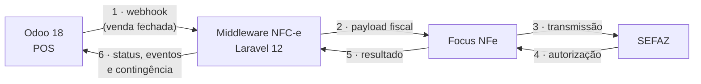

# Módulo Fiscal Brasil — NFC-e

[](https://www.odoo.com)


Controle tributário completo no Odoo 18 (NCM, CFOP, PIS/COFINS) e emissão de
NFC-e direto no PDV, integrado a um [middleware Laravel](https://github.com/marceru1/middleware_nfce)
com a API da Focus NFe.

## Pra quê: o POS como frente de venda de um ERP

A arquitetura foi desenhada com um objetivo: adaptar o PDV do Odoo para servir
de ponto de venda de um ERP — o operador de caixa **finaliza a venda sem sair
do PDV**, e tudo que a operação pede acontece dentro do fluxo de fechamento do
pedido: dados fiscais do item, emissão de NFC-e, contingência offline, crédito
A Prazo e impressão de cupom. O resto do ERP (estoque, financeiro, cadastros)
fica atrás do balcão, no próprio Odoo.

**Em operação hoje:** 4 caixas em produção.

## O que o módulo faz

- **Tributação nos produtos** — NCM (tabela completa carregada por CSV), CFOP
  e PIS/COFINS por produto/variante, com configuração central nas Configurações.
- **NFC-e no PDV** — a venda sai do POS para o middleware, que assina (certificado
  A1), transmite e devolve status. Contingência offline implementada no JavaScript
  do POS, com QR code no cupom.
- **Etiquetas de produto** — wizard de impressão em QWeb com layouts por linha
  de produto, respeitando folha pré-impressa e múltiplas etiquetas por página.
- **Venda A Prazo** — crédito no PDV por funcionário: cota, registro de pagamento
  com fatura vinculada no histórico (backfill idempotente a cada upgrade).
- **Fechamento e gestão de caixa** — reimpressão do fechamento em HTML válido,
  consulta de vendas por caixa/dia e análise de pedidos.
- **Operação no PDV** — atalhos por teclado (só letras, nunca dígitos — o teclado
  numérico é do operador), cupom customizado e ajustes de layout nas telas do POS.

## Arquitetura



O módulo cuida do lado Odoo (dados fiscais, fluxo de venda, contingência, impressão).
Assinatura, transmissão e eventos fiscais rodam no middleware — que também é open source.

## Por que um middleware entre o Odoo e a SEFAZ?

- **O caixa não pode esperar a SEFAZ.** Transmissão é lenta e instável, e o
  operador precisa de resposta na hora. A fila do middleware desacopla: a venda
  fecha no PDV e a nota busca sua vez, com retorno reconciliável e idempotente.
- **Contingência offline.** Internet caiu, operação continua: a gestão da
  numeração e do estado offline fica entre o JS do POS e o middleware, não no
  caminho crítico da SEFAZ.
- **Certificado A1 isolado.** Assinatura, certificado e senha vivem só no
  middleware — nunca chegam ao navegador nem ficam expostos na instância do Odoo.
- **Emissor substituível.** O provedor (hoje Focus NFe) é detalhe de
  implementação: trocar de provedor ou abrir um motor próprio não mexe no Odoo.
- **Contrato, não acoplamento.** O webhook autenticado do middleware é o ponto
  de extensão: hoje a fonte é o POS do Odoo, amanhã pode ser qualquer sistema.
- **Odoo segue sendo Odoo.** Sem lógica de transmissão espalhada pelo core:
  as diferenças por estado e de homologação ficam num único lugar.

## De onde veio e quem pode usar

O módulo nasceu num caso real: uma loja física com múltiplos caixas rodando o
POS como frente de venda. Os layouts de etiqueta (Bijuteria 34,9×20,1 mm e
Confecção 105×60 mm) refletem as linhas de produto desse caso — estão aqui como
exemplo funcional e como prova de que o mecanismo funciona em produção.

O núcleo, no entanto, é genérico: NCM/CFOP/PIS/COFINS nos produtos, NFC-e no
PDV, contingência, crédito A Prazo, fechamento. **Quem roda Odoo 18 com POS no
Brasil e quer NFC-e pode usar e adaptar** — os templates de etiqueta se
duplicam e se ajustam à sua realidade em minutos.


## Instalação

```bash
git clone https://github.com/marceru1/modulo-fiscal-odoo.git
# coloque a pasta no addons_path da sua instância Odoo 18
# Apps → Atualizar lista → instalar "Módulo Fiscal Brasil - NFC-e"
```

A tabela NCM carrega a partir de `meu_modulo_fiscal/data/br.ncm.csv`. Para
desenvolvimento/servidor, há `Dockerfile`, `odoo.conf.docker` e `start.sh` no repositório.

## Testes

O desenvolvimento segue pipeline documentado no próprio repositório (`AGENTS.md`):
spec → tasks → código → revisão, com suíte de regressões HTTP e de layout.

```bash
# login de teste em bases já populadas:
export MFISCAL_TEST_LOGIN=seu_login
odoo-bin -d sua_base --test-enable --stop-after-init -u meu_modulo_fiscal
```

## Estado

Em desenvolvimento ativo, com **4 caixas em produção** rodando em loja física.
Próximos passos: NF-e modelo 55 e mais cobertura nos eventos fiscais.

## Licença

A definir (candidata: MIT). Consulte antes de usar em produção.
